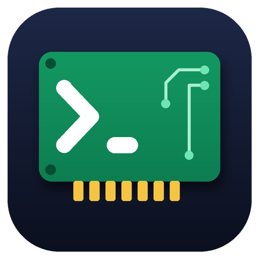

# Vision

Donanım kartlarına telnet ile bağlanmak, birden çok kartın çıktısını aynı anda izlemek, kartlara toplu komut göndermek ve kartların dosya sistemini gezmek için Windows masaüstü uygulaması.

Geliştiren: **Ali Bedir**

> Önceki adı: Telnet Kart Terminali. Önceki sürümün ayarları yeni adla da okunur.

## Özellikler

- Grup tabanlı kart yönetimi (Kart Gezgini), kartlara isteğe bağlı ad
- Aynı anda en fazla 12 kart terminali; bağlantı ve görünüm birbirinden bağımsız
- Bağlantı süresi, kaydırma koruması ve yeni satır göstergesi, kart başına komut geçmişi ve otomatik tamamlama
- Genel komut çubuğu: ekrandaki tüm kartlara aynı komut
- Periyodik bağlantı izleme ve otomatik yeniden bağlanma
- Kart Dosya Gezgini: `devs` / `ll`, klasör ve dosya işlemleri, FTP üzerinden karta yükleme, salt okunur "Birlikte aç"
- Komut Kütüphanesi: komutları modüllerde gruplama (ör. "Task komutları")
- Türkçe arayüz ve hata mesajları, uygulama içi yardım (F1)

## Gereksinimler

| | |
|---|---|
| Çalıştırma | Windows 10 / 11, .NET Framework 4.6.1 veya üstü |
| Geliştirme | Visual Studio 2019 (16.11), C# 7.3; NuGet paketi gerekmez |

## Derleme

1. `Vision.sln` dosyasını Visual Studio 2019 ile açın.
2. **Build → Build Solution** (Ctrl+Shift+B).
3. Çıktı `bin\Debug\` (ya da `bin\Release\`) klasöründedir. `Yardim\` ve `Komutlar\` klasörleri exe'nin yanına kopyalanır.

## Klasör yapısı

| Konum | İçerik |
|---|---|
| `*.cs` | Kaynak kod (WinForms) |
| `Yardim\` | Kullanım Kılavuzu ve Gereksinimler (uygulama içi yardımda gösterilir) |
| `Komutlar\Komutlar.xml` | Komut Kütüphanesi başlangıç dosyası (derlemede yalnız hedefte yoksa kopyalanır) |
| `Vision.ico` | Uygulama simgesi (`docs/simge.png`: büyük önizleme) |

Çalışırken exe'nin yanında `Konfig\config.xml` (gruplar, kartlar, ayarlar) ve `logs\` oluşur; bunlar depoya alınmaz.

## Ayrıntılı belgeler

- [Kullanım Kılavuzu](Yardim/KullanimKilavuzu.md)
- [Gereksinimler ve sürüm notları](Yardim/Gereksinimler.md)
