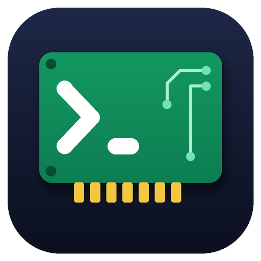

# Vision

Donanım kartlarına telnet ile bağlanmak, birden çok kartın çıktısını aynı anda izlemek, kartlara toplu komut göndermek ve kartların dosya sistemini gezmek için Windows masaüstü uygulaması.

Geliştiren: **Ali Bedir**

> Önceki adı: Telnet Kart Terminali. Önceki sürümün ayarları yeni adla da okunur.

## Özellikler

- Grup tabanlı kart yönetimi (Kart Gezgini), kartlara isteğe bağlı ad
- Aynı anda en fazla 24 kart terminali; bağlantı ve görünüm birbirinden bağımsız
- Bağlantı süresi, kaydırma koruması ve yeni satır göstergesi, kalıcı komut geçmişi (geçmiş penceresi, Ctrl+R ile geriye doğru arama) ve otomatik tamamlama, kart ekranında sağ tıkla renklendirme
- İlk açılışta kullanıcıyla birlikte adım adım ilerleyen etkileşimli uygulama turu: kart ekletir, bağlatır, kart penceresini, boot ayarlarını, renklendirmeyi, Kart Dosya Gezgini'ni, Seri sekmesini, Sentinel'i ve Komut Kütüphanesi'ni tek tek anlatır (atlanabilir, Yardım → Uygulama turu ile yeniden açılır)
- Boot ayarları penceresi: `bspBootChange` / `bootChange` alanları araya giren loglardan ayrı, tek ekranda izlenir ve düzenlenir
- Genel komut çubuğu: ekrandaki tüm kartlara aynı komut; bspBootChange gönderilince tek pencerede kart listesi ve seçilen kartın boot ekranı
- reboot onayında "Temizleyip yeniden başlat": önce ekranı temizler, açılış çıktısı temiz ekranda görünür (kartta ve genel komut çubuğunda)
- Boot ayarı kayıtları: kartın boot ayarlarını adıyla saklama (kart başına 5), şu anki ayarlarla karşılaştırma, önizleme + onayla aynı ya da başka karta geri yükleme ve doğrulama
- Kart başına olay günlüğü: bağlantı / kopma, reboot, boot ayarı değişiklikleri (eski → yeni), Sentinel, dosya işlemleri ve aktarımlar; süzme, arama, CSV'ye kaydetme
- Periyodik bağlantı izleme ve otomatik yeniden bağlanma; kesinti bir kez yazılır, bağlantı gelince toplam süre; kendi gönderdiğimiz reboot'ta kırmızı uyarı yerine "yeniden başlatılıyor"
- Kart Dosya Gezgini: `devs` ile hızlı cihaz listesi, `ll`, klasör ve dosya işlemleri; bilgisayardan karta ve karttan bilgisayara (masaüstüne / herhangi bir klasöre) sürükle-bırak, FTP üzerinden karta yükleme ve karttan alma (büyük dosyalar iki yönde de parça parça; ilerleme penceresinde anlık hız, kalan süre ve anında iptal; yüklemede boş alan denetimi; klasör yüklemede gidemeyen dosyalar atlanır, boyutlar doğrulanır, yüklenemeyenler olay günlüğünde tam listelenir), salt okunur "Birlikte aç"
- Seri sekmesi: kartlara TeraTerm yerine COM portundan (USB-seri çevirici) bağlanma; en fazla 12 port ızgarada, port başına ayarlar (baud rate, data, parity, stop, akış denetimi, gecikme) ve ad, Telnet'teki gibi alt komut satırı ve terminale doğrudan yazma (F tuşlarıyla açılış menüleri dahil), ayrı seri komut geçmişi
- Sekmeye göre değişen sol menü (Kart Gezgini / seri portlar / Sentinel kart listesi / komut listesi); her sekmede açık / kapalı durumu ayrı hatırlanır
- Sentinel: kartın içindeki web sunucusunu tek tıkla başlatma / durdurma ve kartın sağlık sayfasını (CPU, task, socket) tarayıcı açmadan uygulama içinde görüntüleme
- Komut Kütüphanesi: exe'ye gömülü, salt okunur 113 VxWorks 6.4 kabuk komutu (açıklama, örnek kullanım, örnek çıktı), modüllerde gruplama ve komutu tek tıkla bir kartın komut satırına aktarma
- 21 hazır tema: Vision temaları (Koyu, Açık, Yüksek kontrast, Matrix) ve popüler editör temaları (Dark Modern, Light Modern, Dark+, Monokai, Solarized Dark, Solarized Light, Dracula, One Dark Pro, GitHub Dark, GitHub Light, Nord, Night Owl, Tokyo Night, Catppuccin Mocha, Gruvbox Dark, Material Theme, Ayu Dark) ve tema düzenleyici: renk değiştirme, anlık önizleme, kaydetme, varsayılana dönme (sekme şeridindeki Temalar menüsü)
- Türkçe arayüz ve hata mesajları, uygulama içi yardım (F1)

## Gereksinimler

| | |
|---|---|
| Çalıştırma | Windows 10 / 11, .NET Framework 4.6.1 veya üstü; Sentinel sayfası için Microsoft Edge WebView2 Runtime (Windows 11 ve güncel Windows 10'da hazır) |
| Geliştirme | Visual Studio 2019 (16.11), C# 7.3; tek NuGet paketi `Microsoft.Web.WebView2` (derlemede otomatik indirilir) |

## Derleme

1. `Vision.sln` dosyasını Visual Studio 2019 ile açın.
2. **Build → Build Solution** (Ctrl+Shift+B).
3. Çıktı `bin\Debug\` (ya da `bin\Release\`) klasöründedir. Kullanım Kılavuzu ve komut kütüphanesi exe'ye gömülüdür.

### Testler

`VisionTests\VisionTests.csproj` ayrı bir konsol projesidir (çözümde; pakete girmez). Derleyip `VisionTests\bin\Release\VisionTests.exe` çalıştırılır (ad filtresi verilebilir: `VisionTests.exe Yukleme`). Kart çıktısı ayrıştırıcıları `VisionTests\Ornekler\` altındaki kart çıktısı örnekleriyle, dosya aktarımları gerçek kart gerektirmeyen sahte kartla (`FakeCard`) sınanır. GitHub Actions her derlemede testleri çalıştırır; bir test bile kalırsa paket ve sürüm oluşmaz.

Hazır paket (`Vision.zip`) düzeni: `Vision\Vision.exe` ve `Vision\lib\` (Sentinel sayfası için Edge WebView2 DLL'leri). Klasör bütün olarak kopyalanmalıdır.

## Klasör yapısı

| Konum | İçerik |
|---|---|
| `*.cs` | Kaynak kod (WinForms) |
| `Yardim\` | Kullanım Kılavuzu (exe'ye gömülür, uygulama içi yardımda gösterilir) ve Gereksinimler (yalnız geliştirici belgesi, uygulamada yok) |
| `Komutlar\Komutlar.xml` | Komut Kütüphanesi içeriği (VxWorks 6.4 komutları); derlemede exe'ye gömülür, dışarıya kopyalanmaz |
| `VisionTests\` | Otomatik testler (ayrı proje; `Ornekler\`: kart çıktısı örnekleri) |
| `Vision.ico` | Uygulama simgesi (`docs/simge.png`: büyük önizleme) |

Gruplar, kartlar ve ayarlar kullanıcının bilgisayarında `%APPDATA%\TelnetCards\config.xml` dosyasında tutulur (yeni sürüme geçişte korunur). Çalışırken exe'nin yanında `logs\` oluşur; depoya alınmaz.

## Sürümler

İlk resmî yayın **v1.0**. `main`'e her birleştirmede küçük sürüm bir artırılır (v1.1, v1.2, …); her sürüm main derlemesinden kendiliğinden GitHub Releases'ta `Vision.zip` ile yayınlanır. Depodaki [`release/`](release/) klasöründe yalnız **güncel sürüm** bulunur: zipten çıkarılmış `release/Vision/` (`Vision.exe` + `lib/`) ve sürüm notları [`release/SurumNotlari.md`](release/SurumNotlari.md). Eski sürümlerin derlenmiş halleri tutulmaz; her birleştirmede yenisiyle değiştirilir.

## Ayrıntılı belgeler

- [Kullanım Kılavuzu](Yardim/KullanimKilavuzu.md)
- [Gereksinimler ve sürüm notları](Yardim/Gereksinimler.md)
- [Yapılacaklar](YAPILACAKLAR.md): kullanıcılardan gelen ve sırada bekleyen istekler
