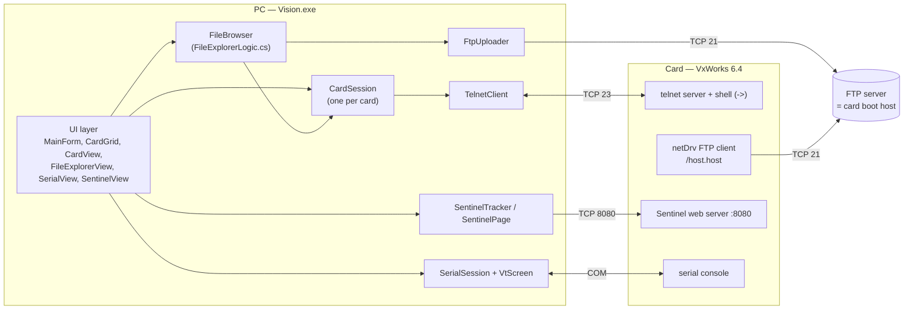
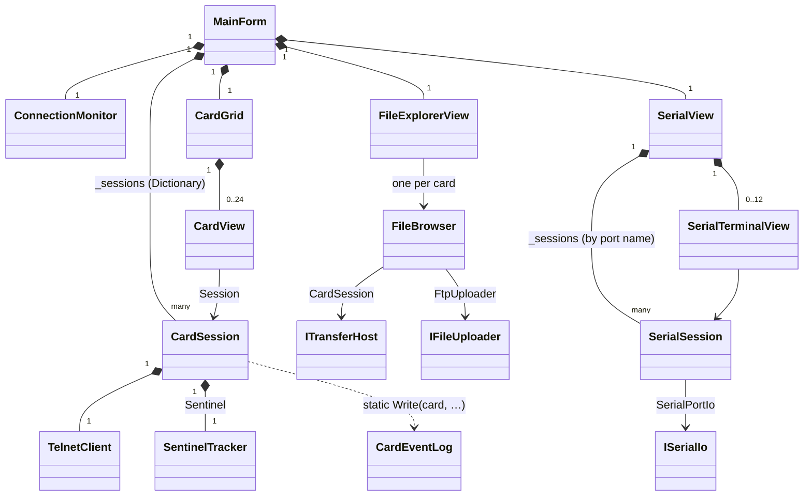

# Architecture

Vision is a single-process Windows Forms application (C# 7.3, .NET Framework 4.6.1) that manages many VxWorks 6.4
cards at once. It installs nothing on the card: it only uses the card's existing telnet shell, the card's FTP network
driver (netDrv), an optional web server that runs on the card (Sentinel), and the serial console.

Related: [modules.md](modules.md) · [execution-flow.md](execution-flow.md) ·
[threading-and-synchronization.md](threading-and-synchronization.md) · [decisions/README.md](decisions/README.md)

## Channels to the card

| Channel | Port / medium | Opened by (PC side) | Purpose |
|---|---|---|---|
| Telnet | TCP 23 (per group: `CardGroup.Port`) | `TelnetClient` (owned by `CardSession`) | Terminal, every shell command, file-explorer commands, boot settings. **One persistent socket per card**, shared by all features. |
| FTP | TCP 21 + data connection (passive by default) | `FtpUploader` (`FtpWebRequest`, one control connection per operation, `KeepAlive = false`) | File **content**. Vision writes to / reads from the FTP server; the card reads / writes the same server through netDrv (`/host.<device>`). |
| Sentinel | TCP 8080 | `SentinelTracker` (connect-and-close probe), `SentinelPage` (WebView2 / WebBrowser HTTP) | Card health page. |
| Serial | COM port | `SerialPortIo` (owned by `SerialSession`) | Console before the network is up (BIOS, boot manager). Independent of telnet. |

The FTP server is the card's **boot host** (`h=` in the boot line). Credentials are read from the card itself
(`version` → `Boot line:`) by `CardFtpConfigurator` and kept in memory only.

## Layers

| Layer | Main types | Rule |
|---|---|---|
| UI | `MainForm`, `CardGrid`, `CardView` (+ `.Actions`, `.Highlights`, `.Sentinel`, `.Tour`), `GlobalCommandBar`, `CardExplorer`, `FileExplorerView` (+ partials), `SerialView`, `SerialTerminalView`, `SerialScreenView`, `SentinelView`, `CommandLibraryView`, dialogs | No protocol logic. Reads session state on the 40 ms UI timer. |
| Session | `CardSession`, `ConnectionMonitor`, `SentinelTracker`, `SerialSession` | State machine, reconnect, command gate, response capture, event log. Thread-safe. |
| Logic | `FileBrowser` (in `FileExplorerLogic.cs`), parsers (`DevsParser`, `LsParser`, `DosFsShowParser`, `BootChangeParser`), `BootChangeRunner`, `CardFtpConfigurator`, `ResponseSplitter`, `VtScreen`, `CommandLibrary` | Pure or nearly pure; most of it is unit-tested. |
| Transport | `TelnetClient`, `FtpUploader`, `SerialPortIo` | Byte level. Abstracted behind `ITransferHost`, `IFileUploader`, `ISerialIo`, `IBootConsole` so tests can substitute fakes. |
| Infrastructure | `ConfigStore` / `AppConfig` / `AppSettings` (`Models.cs`), `CardEventLog`, `ErrorText`, `Theme`, `ThemeCatalog`, `LibFolder`, `TerminalSnapshot` | Persistence, logging, theming. |

## Core principles (confirmed in code and requirements)

1. **One telnet socket per card.** VxWorks sends post-boot logs to the first telnet session; a second socket would split
   them. `FileExplorerView` and `SentinelView` get the *existing* session (`MainForm.GetSession` / `FindSession`) and
   never open their own.
2. **Telnet carries commands, FTP carries content.** Binary data never goes through the shell.
3. **The shell's return line is the protocol.** The VxWorks shell prints `value = N = 0x…` after a function call;
   `CardSession.ExecuteAsync` uses it (or a shell error) as the end-of-command marker. See
   [execution-flow.md](execution-flow.md#command-execution-executeasync).
4. **Nothing installed on the card.** Large transfers call VxWorks C functions from the shell (`open`, `read`, `write`,
   `lseek`, `malloc`, `free`, `close`).
5. **No thread per card.** Everything is `async`/`await` plus a few shared timers; see
   [threading-and-synchronization.md](threading-and-synchronization.md).
6. **Fail safe on the card.** Anything Vision opens or allocates on the card during a transfer is recorded and released
   on cancel, error or reconnect (`CardSession.AddCleanup`, `TransferCleanup`).
7. **Turkish, plain-language UI and messages**; technical detail goes to `logs\hatalar.log` (`ErrorText`).

## Main objects and ownership

Notes:
- `CardSession` objects live for the whole application run once created (lazily, by `MainForm.GetSession`) and are
  disposed in `MainForm.OnFormClosing`.
- A `CardView` can be closed while its session stays alive (`CardSession.DetachView`); the grid shows at most 24 views
  (`CardGrid.MaxViews`).
- `ConnectionMonitor` reads an immutable snapshot array (`MainForm._sessionSnapshot`) from its timer thread.

## Persistent state

| What | Where | Owner |
|---|---|---|
| Groups, cards, serial ports, boot records, theme, monitor settings | `%APPDATA%\TelnetCards\config.xml` | `ConfigStore.Save` (`XmlSerializer` → `config.xml.tmp`, then delete old file and move) |
| Command history | `%APPDATA%\TelnetCards\KomutGecmisi.txt`, `SeriKomutGecmisi.txt` | `CommandHistoryStore`, `SerialHistoryStore` |
| Per-card event log | `<exe>\logs\olaylar\<ip>.log` (TSV, 5 MB cap) | `CardEventLog` |
| Technical errors | `<exe>\logs\hatalar.log` (+ `.1`) | `ErrorText` |
| Terminal snapshots | `<exe>\logs\TelnetLoglari`, `<exe>\logs\SeriKanalLoglari` | `TerminalSnapshot` |

The `%APPDATA%` folder name `TelnetCards` is the application's former name and is intentionally kept
(`AppInfo.DataFolder`).
