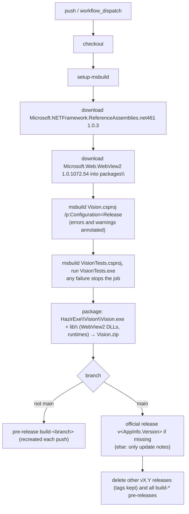

# Build System

Vision is built with MSBuild from a classic (non-SDK) `.csproj`. The authoritative build is the GitHub Actions workflow
`.github/workflows/build-exe.yml`; it builds, runs the tests and packages `Vision.zip`.

Related: [testing-strategy.md](testing-strategy.md) · [release-process.md](release-process.md) ·
[dependencies.md](dependencies.md)

## Requirements

| | |
|---|---|
| OS | Windows (WinForms, `System.IO.Ports`, WMI, WebView2); supported: Windows 10 / 11 |
| IDE / tools | Visual Studio 2019 (16.11) or later with the ".NET desktop development" workload, or MSBuild + .NET Framework 4.6.1 targeting pack |
| Language | C# 7.3 (default for .NET Framework projects in VS 2019) |
| Target | .NET Framework 4.6.1, `WinExe`, `AnyCPU`, configurations `Debug` / `Release` |
| NuGet | `Microsoft.Web.WebView2` 1.0.1072.54 (`packages.config`, restored into `packages/`) |

## Local build

1. Open `Vision.sln` in Visual Studio.
2. Build → Build Solution (Ctrl+Shift+B). NuGet restores the WebView2 package.
3. Output: `bin\Debug\` or `bin\Release\`. The user manual (`Yardim/KullanimKilavuzu.md`) and the command library
   (`Komutlar/Komutlar.xml`) are embedded into the exe.
4. Tests: build `VisionTests\VisionTests.csproj` and run `VisionTests\bin\Release\VisionTests.exe [name-filter]`.

**AI sessions:** the Claude Code environment used for this project is Linux with no .NET Framework toolchain. Code
cannot be compiled or tested locally there; push the branch and let CI build and test it (below). Never report a build
or test result that CI did not produce.

## CI pipeline (`.github/workflows/build-exe.yml`)

Triggers: push to **any branch** (except changes only to `**.md`, `docs/**`, `release/**`), and manual
`workflow_dispatch` (optional input `release_ref` to publish an old commit as the official release).

Details:
- Branch names are sanitised for the tag: `[^A-Za-z0-9._-]` → `-` (e.g. `fix/ftp-gecici-ad` → `build-fix-ftp-gecici-ad`).
- The version is read from `AppInfo.cs` with the pattern `public const string Version = "([0-9.]+)"`.
- Doc-only changes do not run the workflow. To get a build of such a branch anyway, run it manually:
  `gh workflow run build-exe.yml --ref <branch>`.
- Permissions: `contents: write` (to create releases).

## Project file rules

### Adding a source file

`Vision.csproj` lists every file explicitly. A new `.cs` file **must** get a `<Compile Include="File.cs" />` entry
(forms / user controls with `<SubType>Form</SubType>` or `UserControl` like their neighbours; partial files with
`<DependentUpon>Main.cs</DependentUpon>`). A file that exists on disk but not in the project is silently not compiled.
The same applies to `VisionTests/VisionTests.csproj` for new test files.

### Embedded resources

| File | Logical name |
|---|---|
| `Yardim/KullanimKilavuzu.md` | `Yardim.KullanimKilavuzu.md` |
| `Komutlar/Komutlar.xml` | `Komutlar.Varsayilan.xml` |

`Yardim/Gereksinimler.md` is deliberately `None` (not embedded, G33.2).

### Test access

`AppInfo.cs` declares `InternalsVisibleTo("VisionTests")`; test hooks and tunable timings are `internal`.

## Known limitations

- Builds only on Windows.
- The official build depends on GitHub Actions; there is no offline build script yet (idea "İç ağda derleme betiği" in
  [`../YAPILACAKLAR.md`](../YAPILACAKLAR.md)). Locally, Visual Studio builds the same project.
- CI downloads NuGet packages from nuget.org at build time.
- The `.gitattributes` file keeps LF in the repository and CRLF in the working tree for `*.cs`, `*.csproj`, `*.sln`,
  `*.md`, `*.xml`; tools that rewrite files should preserve the working tree's line endings.
