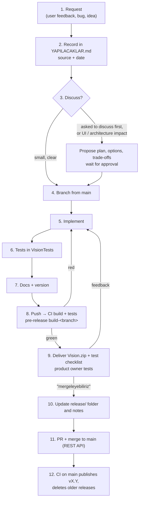

# Development Workflow

This is the process every change follows. It was established over versions 1.0–1.10.1 between the product owner
(Ali Bedir, who writes in Turkish) and Claude Code. A change is **complete only when** code, tests, documentation and
version are done and CI is green; merging additionally needs the product owner's explicit approval.

Related: [testing-strategy.md](testing-strategy.md) · [versioning.md](versioning.md) ·
[release-process.md](release-process.md) · [build-system.md](build-system.md)

Evidence labels: **C** = confirmed (Git history, CI file, repository documents, or explicit decisions in the working
sessions), **I** = inferred.

## Overview

## 1–2. Requests and backlog (C)

- Requests are collected in [`../YAPILACAKLAR.md`](../YAPILACAKLAR.md) with **source** (who, which version) and
  **date**. The rules are at the top of that file.
- **Bugs** are fixed without waiting. **Improvements** are grouped (3–5 related items that fit one test session) and a
  group becomes one version.
- Requests deliberately not done stay under "Yapılmayacaklar" with the reason; check there before proposing a feature.
- When an item is done it is removed from `YAPILACAKLAR.md` and recorded in `Yardim/Gereksinimler.md` (G number).

## 3. Discuss first (C)

- When the product owner says to discuss first ("önce tartışma ve plan çıkarma", "Direkt değişiklik yapmak yok"),
  do **not** write code. Analyse, propose a numbered plan with options and trade-offs, and wait for decisions item by
  item.
- Also propose before implementing when a change adds UI (new buttons, menus, windows), changes behaviour users rely
  on, or touches architecture. The product owner prefers **fewer buttons**.
- Ask instead of guessing card-side facts (key codes, command names); several decisions were corrected by checking how
  TeraTerm or the card actually behaves.
- Questions are asked in Turkish, concisely, with a recommended option.

## 4. Branches (C for the practice, I for the naming rule)

- Always branch from an up-to-date `main`. Never commit to `main` directly.
- Names seen in history: `feature/<topic>`, `fix/<topic>`, `docs/<topic>`, `ci/<topic>`, `chore/<topic>`,
  `seri/<topic>`, `surum/<x.y>`, `deneme/<topic>`. Use lowercase ASCII words joined by `-`, Turkish words allowed
  without Turkish characters (`fix/ftp-gecici-ad`).
- One branch per version or per bug fix; feedback rounds stay on the same branch.

## 5. Implementation rules (C)

- Read the relevant documents in `docs/` and the requirement groups in `Yardim/Gereksinimler.md` first.
- No unrelated refactoring. Keep the existing style ([coding-standards.md](coding-standards.md)).
- New `.cs` files must be added to `Vision.csproj` / `VisionTests.csproj`.
- The AI environment cannot compile: write carefully, then let CI compile. Watch C# string escapes when generating code
  from scripts.

## 6. Tests (C)

Every behaviour change comes with tests in `VisionTests`; every bug fix with a regression test. Details and rules:
[testing-strategy.md](testing-strategy.md).

## 7. Documentation and version (C)

Update in the **same branch**, only what the change affects:

| Change | Update |
|---|---|
| Anything user-visible | `Yardim/KullanimKilavuzu.md` (embedded user manual, Turkish) |
| Visible UI changed (new tab, control, order) | Application tour: steps in `MainForm.BuildTourSteps`, accessors in `TourAccessors.cs` / `CardView.Tour.cs`; raise `AppSettings.CurrentTourVersion` only if users should see the tour again |
| Every feature / fix | `Yardim/Gereksinimler.md`: new `### G<n> — <title> (<version>)` section with table rows `No · Gereksinim · Durum · Nasıl karşılandı` (cause, solution, classes / methods, test names), plus a row in the "Sürüm notları" table |
| Notable feature | `README.md` feature list |
| Code change to be released | Version in `AppInfo.cs` ([versioning.md](versioning.md)) |
| Backlog item done / changed | `YAPILACAKLAR.md` |
| Architecture, workflow, build, tests, dependencies | the matching file in `docs/` |
| New convention | `CLAUDE.md` / `AGENTS.md` |

Rules: `Yardim/Gereksinimler.md` is never shown in the application (G33.2). The manual is Turkish and written for
users, not developers.

## 8. CI and delivery (C)

- Push the branch. If the push is rejected transiently, retry a few times.
- CI builds and tests; on success it publishes the pre-release `build-<branch>` with `Vision.zip`.
- Doc-only branches do not trigger CI; run `gh workflow run build-exe.yml --ref <branch>` if a build is needed.
- Download the zip from the pre-release (REST API) and deliver it to the product owner.
- For versions with UI changes, deliver a **manual test checklist as an interactive, checkable page** (done for 1.9 and
  1.10; the product owner asked for this format from the start).

## 9–11. Merge (C)

- Merge **only** after the product owner says so explicitly (typically "mergeleyebiliriz"). An AI must not merge on its
  own initiative.
- Before merging a code change, on the branch:
  1. Replace `release/Vision/` with the contents of the branch build's `Vision.zip` (`Vision/Vision.exe`, `Vision/lib/…`).
  2. Update `release/SurumNotlari.md`: new version and date on top, "Bu sürümde yeni" rewritten, the previous version
     moved into the "Önceki sürümlerde gelenler" table (newest first).
  3. Commit ("release: Vision X.Y derlemesi ve sürüm notları").
- Open the pull request and merge with a merge commit (`merge_method=merge`). In the AI environment `gh` GraphQL calls
  return 403, so use REST: `gh api -X POST repos/alibedr/Vision/pulls --input pr.json` and
  `gh api -X PUT repos/alibedr/Vision/pulls/<n>/merge -f merge_method=merge`.
- Doc-only changes (e.g. `YAPILACAKLAR.md`, `docs/`) follow the same branch → PR → approved merge path, without version
  or release changes.

## 12. After merge (C)

- CI on `main` creates release `v<AppInfo.Version>` with `Vision.zip` and `SurumNotlari.md`, and deletes other `vX.Y`
  releases (tags kept) and all `build-*` pre-releases ([release-process.md](release-process.md)).
- Check the run succeeded and the release exists; update the local `main`.
- The product owner distributes the exe internally (often only `Vision.exe` is replaced on the internal share).

## Commit and PR conventions (C)

- Commit messages in Turkish: short subject (often with the G number or version), blank line, explanation of cause and
  change. AI-authored commits end with the attribution trailer lines required by the session.
- PR title in Turkish; body with "Özet" (summary) and "Test" (new tests, CI result) sections.

## Communication (C)

- Talk to the product owner in Turkish, plainly; report what changed, the CI test summary, what to test and what is
  still unverified on real hardware.
- When a decision is the product owner's (format, UI, scope), ask; do not decide silently.
