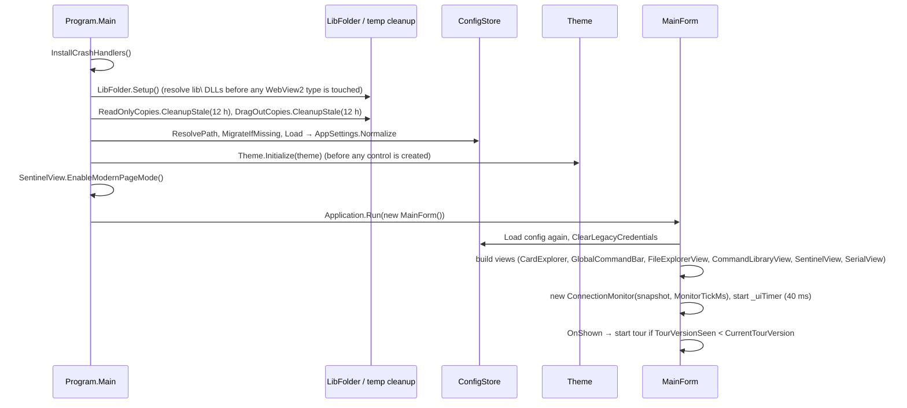
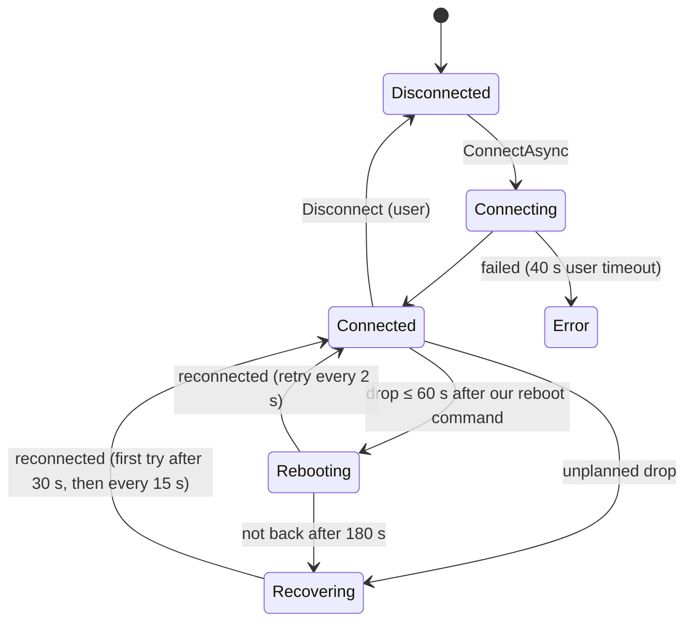
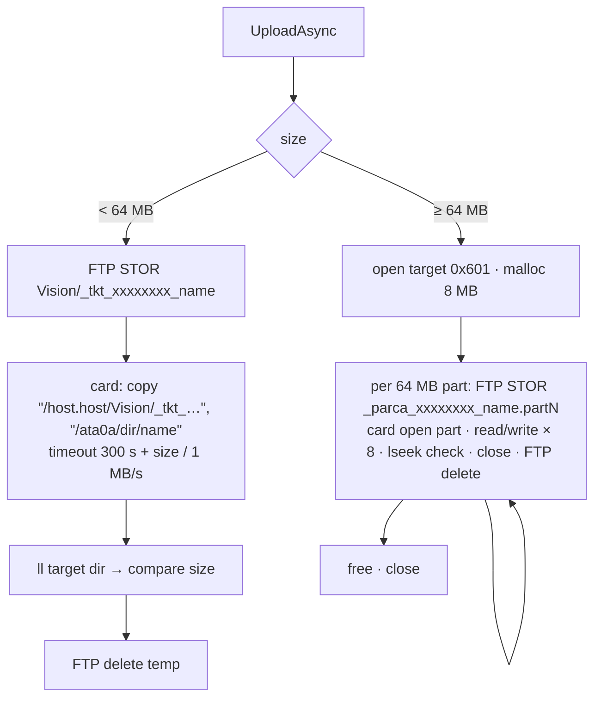

# Execution Flow

Start-up, the steady-state loops, the main runtime sequences, and shutdown. Timing constants are quoted from the code
(version 1.10.1); if you change one, update this file.

Related: [architecture.md](architecture.md) · [threading-and-synchronization.md](threading-and-synchronization.md) ·
[memory-management.md](memory-management.md)

## Start-up

- `Program.InstallCrashHandlers` sets `UnhandledExceptionMode.CatchException`, handles `Application.ThreadException`
  (log + one Turkish message box per 10 s, app keeps running), `AppDomain.UnhandledException` (log; message if
  terminating) and `TaskScheduler.UnobservedTaskException` (log only). All go to `ErrorText.LogCrash`.
- No card connects automatically at start-up; sessions are created lazily by `MainForm.GetSession` when a card is opened
  or used.

## Steady state

| Loop | Period | Thread | Work |
|---|---|---|---|
| `MainForm._uiTimer` → `OnUiTick` | 40 ms | UI | Each `CardView.Tick` pulls pending output from its session and appends it; state colours, buttons, status bar; file-explorer and Sentinel view refresh (signature-based, cheap when nothing changed) |
| `ConnectionMonitor` (`System.Threading.Timer`) | `MonitorTickMs` (1 s default) | thread pool | `CardSession.MonitorTick` for every session in the snapshot: reconnect scheduling, Sentinel probe scheduling; non-blocking |
| `TelnetClient.ReadLoopAsync` | event driven | thread pool | Parse telnet bytes, hand text to `CardSession` |
| `SerialTerminalView._timer` → `Pump` | 50 ms | UI | Move received serial text into `SerialScreen` / `VtScreen` |
| `SerialView._timer` | 3 s | UI | Refresh the list of COM ports |
| `SentinelTracker` probe | 5 s idle, 1 s while starting/stopping | thread pool | TCP connect to card:8080 and close |

## Connection and reconnect

`CardState`: `Disconnected`, `Connecting`, `Connected`, `Error`, `Recovering`, `Rebooting`.

- **Socket set-up** (`TelnetClient.ConnectAsync`): `TcpClient { NoDelay = true, ReceiveBufferSize = 64 KB }`,
  `ConnectAsync` raced against a timeout (40 s for a user connect, `ReconnectTimeoutMs` 3 s for an automatic retry). Each attempt gets a
  number (`_attempt`); a late attempt that lost the race is closed immediately (G54).
- **Telnet negotiation**: every `DO` is answered `WONT`, every `WILL` `DONT`; sub-negotiation is skipped; `0xFF` in data
  is doubled. Encoding ASCII; line ending from settings (CRLF default).
- **Drop detection**: TCP keepalive on the socket (idle 3 s, interval 2 s, 3 probes ⇒ ~9 s), retransmission timeout
  10 s. Values in `config.xml` `<Monitor>` (`ConnectionMonitorOptions`).
- **Outage episode** (G52): from first drop until a connection that holds for 5 s (`ConnectionMonitorOptions.StableAfterMs`);
  short reconnects in between belong to the same episode and are written once with the total duration.
- **Reboot detection**: `CardSession.IsRebootCommand` matches `reboot`, `reboot N`, `reboot(N)`, `FPGAGiveBoardReset`.
  Windows: `ConnectionMonitorOptions.RebootDropWindowMs` 60 s, `RebootReturnMs` 180 s (both in `config.xml` `<Monitor>`).
- **Reconnect order** (G53): VxWorks gives post-boot logs to the first telnet session. The Vision that sent the reboot
  retries every 2 s (`CardSession.OwnRebootRetryMs`); others wait 30 s (`UnplannedFirstDelayMs`) then retry every 15 s
  (`UnplannedRetryMs`). These three are `internal static` (not settings) so tests can shorten them. No retry limit.
- After a reconnect, pending transfer cleanup runs (see [File upload](#file-upload)).

## Command execution (`ExecuteAsync`)

Used by the file explorer, boot records and FTP discovery; output is captured and **not** shown in the terminal.

1. Take the card's command gate (`CardSession._commandGate`, `SemaphoreSlim(1)`).
2. Wait until the line is quiet (no traffic for 200 ms, at most 2 s) unless `chained` (consecutive `read` / `write`).
3. Send the command; poll the capture buffer every 20 ms.
4. Done when a `value = …` line or a shell error (`undefined symbol`, `syntax error`) is seen, followed by 150 ms of
   silence (max 600 ms). Fallback: output ends with the `->` prompt and 500 ms of silence.
5. Otherwise `TimedOut` after `idleTimeoutSec` without data or the overall limit (twice that, at least 20 s).
6. Text captured before the command's echo (late output of earlier work) is given back to the terminal.

`SendCommandAsync` (terminal, quick commands, global bar) goes through the same gate but output stays in the terminal;
`ResponseSplitter` moves return-value lines to the responses panel only while a Vision-sent command is open.

## FTP discovery

`CardFtpConfigurator.ObtainAsync` runs `version` (6 s), parses `Boot line:` with `BootParams`: `h=` server, `u=` user,
`pw=` password, the word after the boot device's `(…)` is the host device name; the card sees the FTP root as
`/host.<device>`. Vision works inside `Vision/` on the server (G22). Credentials live in `CardSession` memory only.

## File upload

- Folders: tree uploaded to `Vision/_tkt_…_<folder>/`; card side `mkdir` per folder and one `copy` per file (no
  `xcopy`, G57); files ≥ 64 MB inside go through the part path; 5 consecutive FTP failures stop the upload; sizes
  verified with one `ll` per folder.
- FAT targets reject single files ≥ 4 GB before anything is sent (`FatMaxFileBytes`).
- Unique FTP names per operation (`FileBrowser.FtpTempName`, `FtpPartBase`) let the same file go to several cards at
  the same time (G60).
- While a transfer runs the card is `TransferActive`: user commands are refused for that card.
- Everything opened or allocated on the card is registered with `CardSession.AddCleanup`. On cancel, error or
  reconnect the cleanup runs; after a reconnect `tickGet` decides whether the card rebooted (then only `rm` of the
  partial target, no `close` / `free`).

## File download

Reverse of upload: card `copy` to an FTP temp file `_tkt_…`, `RETR`, size check, delete temp. ≥ 64 MB: source opened
once on the card, each part written to a new FTP temp file with `read` / `write`, closed (netDrv flushes on close),
downloaded and appended locally. Free space on the PC is checked first. Used by "Bilgisayara kaydet", drag to Windows
(`FileExplorerView.DragOut.cs`, file is fetched only when dropped) and double-click open (`ReadOnlyCopies`).

## Shutdown

`MainForm.OnFormClosing`:

1. If the Command Library has unsaved changes, ask (`ConfirmLeave`).
2. If any session has `TransferActive` (and Windows is not shutting down): ask; on confirm call
   `TransferProgress.CancelAll()`, wait up to 90 s for transfers to finish their cleanup, then `ForceEndTransfers` and
   close.
3. Stop `_uiTimer`, dispose `ConnectionMonitor`, clear the snapshot, `SaveConfig()`, `CardGrid.CloseAll()`, dispose
   every `CardSession` (closes its socket).
4. Back in `Program.Main` (`finally`): `ReadOnlyCopies.CleanupSession()`, `DragOutCopies.CleanupSession()`.
