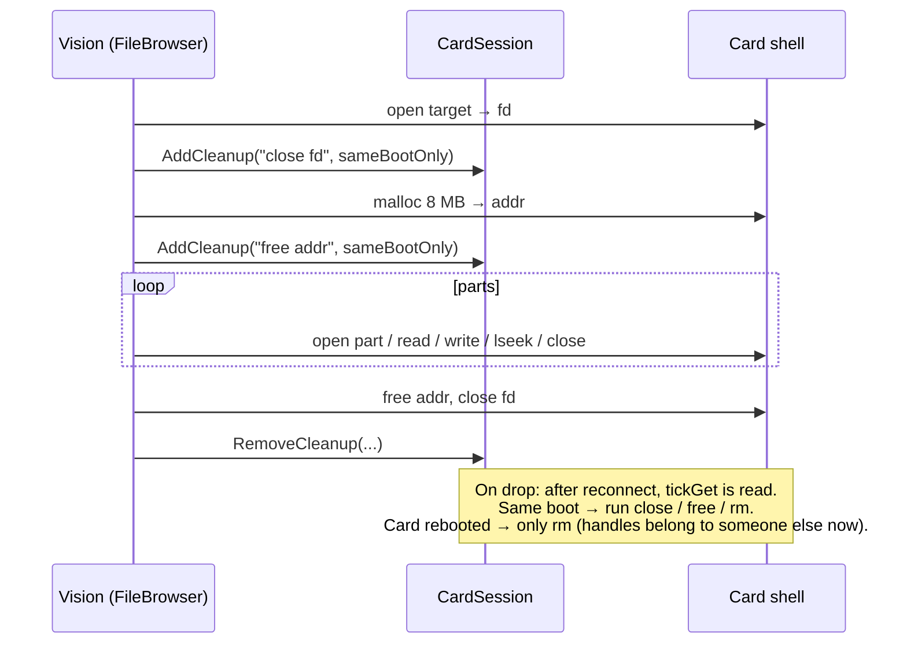

# Memory and Resource Management

Vision is managed code, so "memory management" here is mostly **resource ownership**: sockets, COM ports, timers,
files, and the memory and file handles Vision allocates **on the card** during large transfers. The last one is the
most important: a leak there survives until the card reboots.

Related: [threading-and-synchronization.md](threading-and-synchronization.md) · [execution-flow.md](execution-flow.md)

## Ownership on the PC

| Resource | Owner | Created | Released |
|---|---|---|---|
| Telnet socket (`TcpClient`) | `TelnetClient` (owned by `CardSession`) | `ConnectAsync` | `Disconnect`, a newer attempt (`_attempt`), `CardSession.Dispose` in `MainForm.OnFormClosing` |
| `CardSession` | `MainForm._sessions` | `MainForm.GetSession` (lazy) | `MainForm.OnFormClosing` |
| `CardView` | `CardGrid` | opening a card | closing the view (`CardSession.DetachView` keeps the session) |
| FTP control / data connections | `FtpUploader` (`FtpWebRequest`, `KeepAlive = false`) | per operation | end of the operation (`using` on responses / streams) |
| COM port | `SerialPortIo` (owned by `SerialSession`) | opening the port | closing the port / disposing the session |
| `ConnectionMonitor` timer | `MainForm` | constructor | `OnFormClosing` |
| WebView2 environment | `EdgeSentinelPage` | first time the Sentinel tab shows a running server | disposing the page; user data in `%LOCALAPPDATA%\TelnetCards\WebView2` |
| Read-only and drag-out copies | `ReadOnlyCopies`, `DragOutCopies` | download for open / drag | `CleanupSession` at exit, `CleanupStale(12 h)` at next start |
| `TerminalTap` | boot dialogs | dialog open | `Dispose` when the dialog closes |

Rules:
- Every `IDisposable` you create in a long-lived object must be disposed by that object (`TelnetClient`,
  `ConnectionMonitor`, `SerialSession`, `TourController`, `TerminalTap`, `SentinelPage` are the existing examples).
- Use `using` for short-lived streams, responses and files.
- Scopes that must end are returned as `IDisposable` (`CardSession.BeginTransfer`, `BeginBootAutomation`) and used with
  `using` so the counter is decremented on every path.

## Bounded buffers

| Buffer | Limit |
|---|---|
| Telnet terminal (`RichTextBox`) per card | `AppSettings` line limit (`CardSession.ApplyLineLimit`, `CardView.TrimToLimit`) |
| Session history (`StringBuilder`) | `CardSession.MaxHistoryChars` (4 000 000 chars), trimmed with slack |
| Return values panel (`ResponseSplitter`) | last 200 commands |
| Serial session text (`SerialSession.MaxLines`) | 20 000 lines |
| Event log file per card | 5 MB, trimmed to 4.5 MB |
| `hatalar.log` | 5 MB, then one rotation to `hatalar.log.1` |
| Card-side RAM during a transfer | one 8 MB buffer (+ netDrv's copy of the current 64 MB part) |

## Ownership on the card (transfers ≥ 64 MB)

`FileBrowser.UploadInPartsAsync` / `FetchInPartsAsync` call VxWorks functions through the shell. Each resource is
registered **before** it can leak and removed when released:

| Resource | Acquired with | Released with | Registered via |
|---|---|---|---|
| Target / source file descriptor | `open "<path>", 0x601, 0644` (write) or `open …, 0, 0` (read) | `close <fd>` | `ITransferHost.AddCleanup("fd:N", "close N", 0, sameBootOnly: true, bootTick)` |
| 8 MB buffer | `malloc 8388608` | `free 0x…` | `AddCleanup("buf:0x…", "free 0x…", 1, true, …)` |
| Partial target file | opening the target | `rm "<path>"` on failure / cancel | `AddCleanup("rm:<path>", "rm …", 2, false, …)` |
| FTP temp files (`_tkt_…`, `_parca_….partN`) | FTP `STOR` / card `copy` | FTP delete | `FtpCopyTracker` (also offered to the user later: "FTP kopyalarını sil") |

Rules for new card-side code:
- Never `malloc` / `open` on the card without registering cleanup in the same step.
- Mark handles and memory `sameBootOnly`; mark files to delete as not.
- Keep the card locked with `BeginTransfer` for the whole operation so no user command interleaves with
  `read` / `write` output.
- Verify with `lseek` positions (mod 2³²) or a size check; never assume a write succeeded.

## Managed memory hot spots

- Upload and download stream through 64 MB parts; whole files are never loaded into memory, except in tests.
- `VtScreen` keeps a fixed cell grid (at least 80×25) plus an alternate screen.
- `FakeCard` in tests keeps files in memory; large-file tests use up to ~150 MB.
