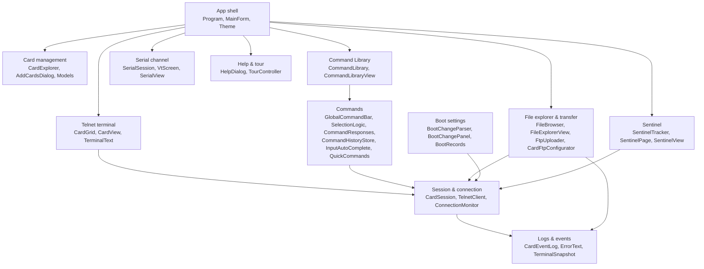

# Modules

Vision has no assemblies or namespaces per module; a "module" here is a **feature area**: a set of files and classes
that change together. For each area: where it lives, the important types and members, how it talks to the rest, the
tests that cover it, and the requirement groups in [`../Yardim/Gereksinimler.md`](../Yardim/Gereksinimler.md) (G…)
that describe its history.

Related: [architecture.md](architecture.md) · [execution-flow.md](execution-flow.md) ·
[testing-strategy.md](testing-strategy.md)

## Map

Serial is the only feature that does not use `CardSession`.

---

## App shell

| | |
|---|---|
| Files | `Program.cs`, `MainForm.cs`, `AppInfo.cs`, `Theme.cs`, `ThemeCatalog.cs`, `ThemeEditorDialog.cs`, `DarkControls.cs`, `Icons.cs`, `ExplorerDialogs.cs` (`DarkDialog`, `InputDialog`, `ChoiceDialog`, `TextViewerDialog`), `LibFolder.cs` |
| Key members | `Program.Main`, `Program.InstallCrashHandlers`; `MainForm` constructor, `OnUiTick` (40 ms `_uiTimer`), `GetSession` / `FindSession`, `ShowTab`, `OnFormClosing`; `Theme.Initialize`; `IconRenderer` (icons are drawn in code, no image files) |
| Notes | Tabs: Telnet (internal name *Workspace*), Kart Dosya Gezgini, Seri, Sentinel, Komut Kütüphanesi (Ctrl+1…5). `DarkDialog.BuildFooter` must keep `AcceptButton` / `CancelButton` (fixed in 1.10, G59). |
| Tests | `SettingsTests` (theme / settings parts) |
| History | G2, G14, G15, G25, G30, G33, G43, G44, G56 |

## Card management and configuration

| | |
|---|---|
| Files | `Models.cs` (`CardConfig`, `CardGroup`, `AppSettings`, `AppConfig`, `ConfigStore`, `ConnectionMonitorOptions`, `IpUtil`), `CardExplorer.cs`, `AddCardsDialog.cs`, `SelectionLogic.cs` |
| Key members | `ConfigStore.ResolvePath`, `MigrateIfMissing`, `Load`, `Save`; `AppSettings.Normalize`; `CardConfig.Label` ("IP" or "IP (name)"); `SelectionLogic.CompareDisplayOrder` (group order, then numeric IP), `DecideConnection`, `LimitExact` / `LimitAdditive` (24-view limit) |
| Notes | `config.xml` element names are Turkish (`<BootKayitlari>`, `<SeriPortlar>`). New settings must default safely so old files keep loading. |
| Tests | `SettingsTests` |
| History | G3, G10, G17, G18, G29, G58 |

## Session and connection (telnet)

| | |
|---|---|
| Files | `CardSession.cs`, `TelnetClient.cs`, `ConnectionMonitor.cs`, `TerminalText.cs` (`LineNormalizer`, `EchoFilter`, `CommandHistory`, `LineBudget`) |
| Key members | `CardSession.ConnectAsync`, `Disconnect`, `MonitorTick`, `TryRecoverAsync`, `SendCommandAsync`, `ExecuteAsync`, `SendInputLineAsync`, `SendRawAsync`, `State`, `StateChanged`, `BeginTransfer` / `TransferActive`, `AddCleanup` / `RemoveCleanup`, `InteractiveInputActive`, `BootInputLocked`; `TelnetClient.ConnectAsync`, `ReadLoopAsync`, `KeepAliveOptions`; `CardState` enum |
| Notes | One socket per card. Telnet options are all refused. Reconnect timings are `internal static` so tests can shorten them. See [execution-flow.md](execution-flow.md#connection-and-reconnect). |
| Tests | `ConnectionTests` (uses a real `TcpListener` fake server) |
| History | G1, G5, G7, G18, G52, G53, G54 |

## Telnet terminal view

| | |
|---|---|
| Files | `CardGrid.cs`, `CardView.cs` (+ `.Actions`, `.Highlights`, `.Sentinel`, `.Tour`), `TerminalHighlight.cs`, `TerminalSnapshot.cs` |
| Key members | `CardGrid.Tick`, `MaxViews` (24), `SortViews`; `CardView.Tick`, `AppendOutput`, `TrimToLimit`, `ColorizeAlerts`, `ApplyHighlights`, `ApplyInputLook`, `RefreshBootLock`; `TerminalSnapshot.SaveAsync` |
| Notes | Terminal is a `RichTextBox`; output is pulled from the session on the UI timer, never pushed from socket threads. |
| History | G4, G19, G24, G26, G50 |

## Commands

| | |
|---|---|
| Files | `GlobalCommandBar.cs`, `SelectionLogic.cs` (`CommandBroadcaster`, `BroadcastResult`, `RepeatGuard`), `CommandResponses.cs` (`ResponseSplitter`), `CommandHistoryStore.cs`, `CommandHistoryDialog.cs`, `InputAutoComplete.cs` (`InputAutoComplete`, `GhostText`, `HistoryWheel`), `QuickCommands.cs` |
| Key members | `GlobalCommandBar.BroadcastAsync`; `CommandBroadcaster.SendToAllAsync` (parallel, skips busy cards); `ResponseSplitter` (return values panel); `CardSession.IsRebootCommand` |
| History | G19, G45, G46, G58 |

## Command Library

| | |
|---|---|
| Files | `CommandLibrary.cs` (`CommandDoc`, `CommandModule`, `CommandLibraryFile`), `CommandLibraryView.cs` (+ `.Pages`, `.Transfer`), `Komutlar/Komutlar.xml` |
| Key members | `CommandLibrary.Embedded()`; `CommandLibraryView.EnableTransfer` ("Karta aktar" writes into a card's input line, does not send) |
| Notes | Content is an embedded resource; changing commands means editing `Komutlar/Komutlar.xml` and releasing a new build. |
| History | G10, G13, G20, G21 |

## File explorer and transfer

| | |
|---|---|
| Files | `FileExplorerLogic.cs` (`FileBrowser`, `ITransferHost`, `DevsParser`, `LsParser`, `DosFsShowParser`, `FsPath`, `FolderPlan`, `OpResult`, `ShellResponse`), `FileTransfer.cs` (`TransferSettings`, `IFileUploader`, `FtpUploader`, `FtpDiagnostics`, `PasswordProtector`), `CardFtp.cs` (`CardFtpConfigurator`, `BootParams`, `FtpCopyTracker`), `FileExplorerView.cs` (+ `.DragOut`, `.MultiSelect`, `.Operations`), `UploadProgress.cs` (`TransferProgress`, `UploadProgressDialog`, `DownloadProgressDialog`), `ReadOnlyOpen.cs` |
| Key members | `FileBrowser.LoadDevicesAsync`, `OpenAsync`, `UploadAsync`, `FetchCopyAsync`, `TransferAsync`, `DeleteAsync`, `ObtainFtpAsync`, `DeleteFtpCopiesAsync`, `FtpTempName`, `FtpPartBase`, `UploadInPartsAsync`, `FetchInPartsAsync`, `PartThresholdBytes` (64 MB), `FatMaxFileBytes`; `CardFtpConfigurator.ObtainAsync` |
| Notes | Algorithms are described in [execution-flow.md](execution-flow.md#file-upload). Every FTP name used during an upload is unique per operation (`_tkt_…`, `_parca_…`, 1.10.1). |
| Tests | `TransferTests` (with `FakeCard`, `FakeFtp`), `ParserTests` |
| History | G6, G9, G16, G22, G23, G31, G34, G39–G42, G47, G57, G60 |

## Boot settings

| | |
|---|---|
| Files | `BootChange.cs` (`TerminalTap`, `BootChangeParser`, `BootField`), `BootChangePanel.cs`, `BootChangeDialog.cs`, `BootChangeMultiDialog.cs`, `BootRecords.cs` (`BootRecord`, `BootRecordLogic`, `BootChangeRunner`, `IBootConsole`, `SessionBootConsole`), `BootRecordsDialog.cs` |
| Key members | `BootChangeParser.IsBootChangeCommand`; `BootChangeRunner.ReadAsync`, `ApplyAsync`; `BootRecordLogic.Plan` |
| Notes | While a boot window is open the card is `InteractiveInputActive`; the multi-card window also sets `BootInputLocked`. |
| Tests | `BootRecordTests` (`FakeBootCard`), `ParserTests` |
| History | G27, G51, G58 |

## Serial channel

| | |
|---|---|
| Files | `SerialCore.cs` (`SerialPortProfile`, `SerialPorts`, `ISerialIo`, `SerialPortIo`, `SerialSession`, `SerialScreen`, `SerialLineCapture`, `SerialHistoryStore`), `SerialVt.cs` (`VtScreen`, `SerialViewMode`), `SerialScreenView.cs` (`SerialKeys`, `SerialScreenView`), `SerialTerminalView.cs`, `SerialView.cs`, `SerialSettingsDialog.cs` |
| Key members | `SerialSession` send loop (char / line delays, key sequences kept whole), `SerialKeys` (TeraTerm key codes), `VtScreen` (VT100/ANSI emulator, Log ↔ Screen mode detection, `Resize`) |
| Notes | Independent of `CardSession`; up to 12 ports. Port encoding ISO-8859-1 with a stateful UTF-8 decoder on top. |
| Tests | `SerialTests` (`FakeSerialIo`) |
| History | G55, G56, G59 |

## Sentinel

| | |
|---|---|
| Files | `Sentinel.cs` (`SentinelTracker`, `SentinelProbe`, `SentinelStatus`), `SentinelPage.cs` (`EdgeSentinelPage`, `LegacySentinelPage`), `SentinelView.cs`, `CardView.Sentinel.cs` |
| Key members | `SentinelTracker.StartCommand`, `Port` (8080), `UrlFor`; `SentinelView.EnableModernPageMode` |
| Notes | Card side is a separate project by a colleague; needs a current Voltran image. |
| History | G28, G37 |

## Logs and events

| | |
|---|---|
| Files | `EventLog.cs` (`CardEventLog`, `CardEvent`), `EventLogDialog.cs`, `ErrorText.cs`, `TerminalSnapshot.cs` |
| Key members | `CardEventLog.Write`, `Read`, `ToCsv`, categories as constants (e.g. `CardEventLog.Sentinel`); `ErrorText.Describe`, `LogTechnical`, `LogCrash`, `LogPath` |
| Tests | `EventLogTests` |
| History | G43, G49 |

## Help and tour

| | |
|---|---|
| Files | `HelpDialog.cs`, `HelpMarkdown.cs`, `Tour.cs` (`TourController`, `TourStep`), `TourAccessors.cs`, `CardView.Tour.cs`, tour steps in `MainForm.BuildTourSteps` |
| Notes | The tour must be updated when a feature changes visible UI (see [development-workflow.md](development-workflow.md)). `AppSettings.CurrentTourVersion` controls whether the tour starts automatically again. |
| History | G8, G32, G36 |
