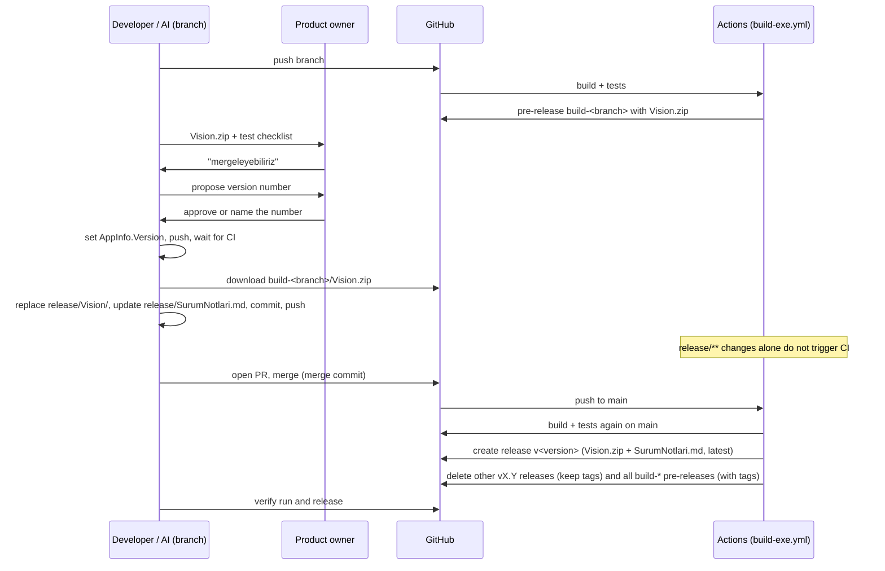

# Release Process

Releases are produced by CI from `main`. The only manual steps are preparing the `release/` folder and the release
notes on the branch before the (approved) merge.

Related: [versioning.md](versioning.md) · [build-system.md](build-system.md) ·
[development-workflow.md](development-workflow.md)

## What a release is

| Item | Value |
|---|---|
| Where | GitHub Releases of `alibedr/Vision` |
| Tag / title | `v<AppInfo.Version>` / `Vision <version>` (e.g. `v1.10.1`, "Vision 1.10.1"), marked *latest* |
| Assets | `Vision.zip`, `SurumNotlari.md` |
| Body | contents of `release/SurumNotlari.md` |
| Zip layout | `Vision/Vision.exe`, `Vision/lib/Microsoft.Web.WebView2.Core.dll`, `Vision/lib/Microsoft.Web.WebView2.WinForms.dll`, `Vision/lib/runtimes/win-{x86,x64,arm64}/native/WebView2Loader.dll` (plus `Vision.exe.config` if the build produces one) |
| Kept | Only the latest official release is visible; older `vX.Y` releases are deleted but **their tags remain** |
| In the repository | `release/Vision/` = the unzipped current release; `release/SurumNotlari.md` = its notes. No older binaries are kept |

## Sequence

## Release notes (`release/SurumNotlari.md`)

Turkish, for users. Structure (keep it):

1. `# Vision <version> — Sürüm notları` and `**Yayın tarihi:** DD.MM.YYYY`.
2. Intro: only the current version is in this folder.
3. `## Kurulum`: copy the whole `Vision` folder, run `Vision.exe`, `lib` must stay next to it; requirements; updating
   keeps settings (`%APPDATA%\TelnetCards`); logs are next to the exe.
4. `## Bu sürümde yeni`: user-language bullets, bold lead phrase per bullet.
5. `## Önemli notlar`: lasting caveats (serial port exclusive, log folders, plain-text FTP password in boot records,
   run from a local folder not a network share, how to report problems).
6. `## Önceki sürümlerde gelenler`: table `Sürüm | Değişiklikler`, newest first; the previous "Bu sürümde yeni" is
   condensed into one row here at each release.

## Special cases

| Case | What happens |
|---|---|
| Merge without code change (docs only) | CI is not triggered (`paths-ignore`), no release |
| Main build for a version that already has a release | CI only refreshes the release notes and the attached `SurumNotlari.md`; `Vision.zip` is not replaced |
| Publish an old commit as the official release | `workflow_dispatch` with `release_ref=<sha>` (cleanup step is skipped in that mode) |
| Hot fix | Patch version (e.g. 1.10.1) through the normal branch / PR path |

## Distribution outside GitHub

The product owner copies the release to an internal network share; users copy the `Vision` folder to their own
machine. Users should **not** run Vision directly from the share (stated in the release notes since 1.10.1). For small
fixes the product owner may only replace `Vision.exe` when `lib/` did not change.
