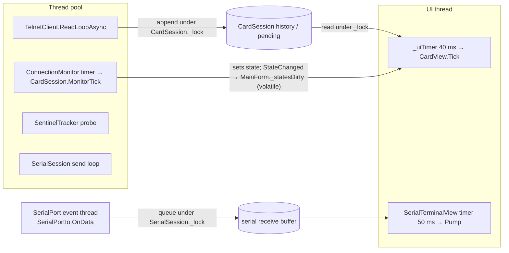

# Threading and Synchronization

Vision never creates a thread per card. Concurrency comes from `async`/`await` on I/O, a handful of timers, and the
`SerialPort` event thread. Shared state is protected by small, local locks; the UI reads state by **polling** on its
40 ms timer instead of being called from background threads.

Related: [execution-flow.md](execution-flow.md) · [memory-management.md](memory-management.md) ·
[architecture.md](architecture.md)

## Execution contexts

| Context | What runs there |
|---|---|
| UI thread (STA, WinForms `SynchronizationContext`) | All controls; `MainForm._uiTimer` (40 ms), `SerialTerminalView._timer` (50 ms), `SerialView._timer` (3 s), dialogs; `FileBrowser` operations started from the UI (their `await`s resume on the UI thread) |
| Thread pool | `TelnetClient.ReadLoopAsync` and its continuations, `ConnectionMonitor` (`System.Threading.Timer`), `SentinelTracker` probes, `FtpUploader` I/O, `SerialSession` send loop (`Task.Run(SendLoopAsync)`) |
| `SerialPort` event thread | `SerialPortIo.OnData` (raises `Received`; must stay short) |

## Rules

1. **Never touch a control from a background thread.** Background code updates session state under its lock and, at
   most, sets a flag (`MainForm._statesDirty`, `volatile`). The UI timer reads it. Avoid adding `Invoke` /
   `BeginInvoke` from session or transport classes; none exist today.
2. **One command at a time per card.** Every path that writes a command to a card's shell goes through
   `CardSession._commandGate` (`SemaphoreSlim(1, 1)`): `SendCommandAsync`, `ExecuteAsync`, boot automation. Inside
   `TelnetClient`, `_writeLock` (`SemaphoreSlim`) additionally serialises socket writes.
3. **State under `CardSession._lock`.** State, timestamps, outage bookkeeping, FTP credentials, the response log and the
   capture buffer are read and written under the session's private `_lock`. Keep critical sections short and never
   `await` inside a `lock`.
4. **Re-entrancy guards with `Interlocked`.** `CardSession.TryRecoverAsync` uses `Interlocked.CompareExchange` on
   `_recoverBusy` so overlapping monitor ticks never start two reconnects. `TransferActive` and `BootAutomationActive`
   are counters read with `Volatile.Read`.
5. **Snapshot for cross-thread enumeration.** `ConnectionMonitor` enumerates `MainForm._sessionSnapshot`, an immutable
   array replaced (not mutated) when a session is added; the `Dictionary` of sessions is only touched on the UI thread.
6. **`ConfigureAwait(false)` in session and transport code** (`CardSession`, `TelnetClient`, `FileTransfer.cs`,
   `SerialCore.cs`, `Sentinel.cs`, `BootRecords.cs`). UI-side code (`FileExplorerView`, `FileExplorerLogic.cs`) awaits
   without it so continuations return to the UI thread. Follow the convention of the file you edit.
7. **Do not block on async code on the UI thread** (`.Result`, `.Wait()`, `GetAwaiter().GetResult()`): the UI context
   would deadlock with continuations that need it. Tests may block because the console runner has no synchronization
   context.

## Locks and primitives in use

| Owner | Primitive | Protects |
|---|---|---|
| `CardSession` | `object _lock` | State machine, timestamps, outage data, FTP credentials, response log, capture |
| `CardSession` | `SemaphoreSlim _commandGate (1,1)` | Exclusive shell access |
| `CardSession` | `Interlocked` on `_recoverBusy`, `_transferDepth`, `_bootAutomation` | Reconnect re-entrancy, transfer / boot scopes |
| `TelnetClient` | `object _sync` | `_attempt`, `_connecting`, current `TcpClient` |
| `TelnetClient` | `SemaphoreSlim _writeLock` | Socket writes |
| `SerialSession` | `object _lock`, `SemaphoreSlim _sendSignal (0)` | Receive / send queues; wakes the send loop |
| `SentinelTracker` | `object _lock` | Status and probe schedule |
| `TransferProgress` | `object _lock` (instance); static `Running` list | Progress counters; `CancelAll` registry |
| `CardEventLog` | static `Lock` | Event log files |
| `ErrorText` | static `LogLock` | `hatalar.log` |

## Timing-sensitive code

| Where | Constants |
|---|---|
| `CardSession.ExecuteAsync` | 200 ms quiet line before sending (max 2 s), 20 ms polling, 150 ms (max 600 ms) silence after `value =`, 500 ms prompt fallback |
| `BootChangeParser` / `TerminalTap` | 120 ms stable last line = waiting for input; value within 40 ms certain, up to 250 ms conditional |
| `VtScreen` mode detection | 3 absolute cursor moves within 2 s → Screen; 25 line feeds without positioning → Log |
| `SerialSession` | per-port character delay (0–1000 ms) and line delay (0–5000 ms); key escape sequences are written whole (`IsKeySequence`) |
| Reconnect, keepalive, outage | see [execution-flow.md](execution-flow.md#connection-and-reconnect) |

These were tuned against real cards. Change them only with a reason recorded in `Yardim/Gereksinimler.md`.

## Known risks

- **UI cost with many busy cards** (inferred from code, not measured): every card with new output is redrawn on each
  40 ms tick and, once the line limit is reached, `CardView.TrimToLimit` deletes old lines on every append. Logged as
  "Çok kartlı kullanımda performans" in [`../YAPILACAKLAR.md`](../YAPILACAKLAR.md).
- **FTP server shared by many cards**: correctness relies on unique temp names per operation (G60). Any new feature
  that writes to the FTP work folder must use `FileBrowser.FtpTempName` / `FtpPartBase`.
- **Several Visions on one card**: allowed by design; only the reconnect order is coordinated (by timing), nothing else.
